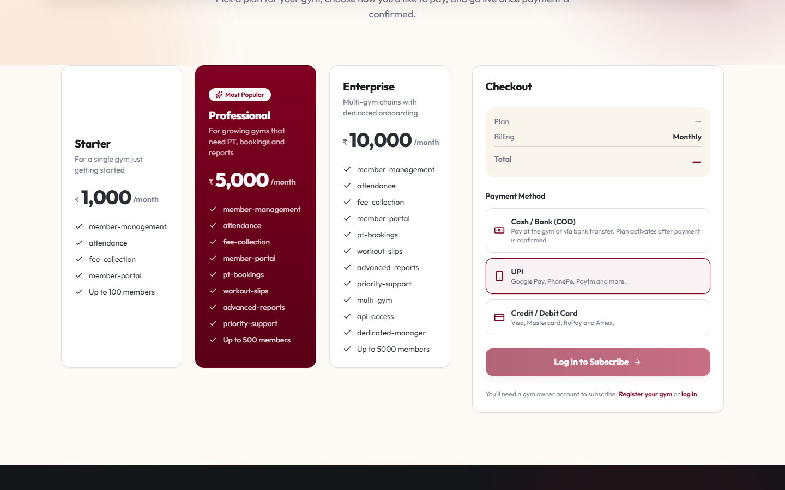
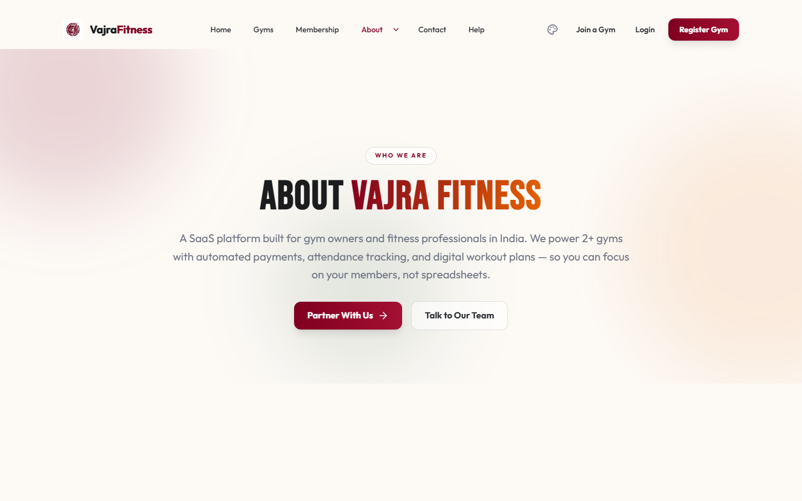
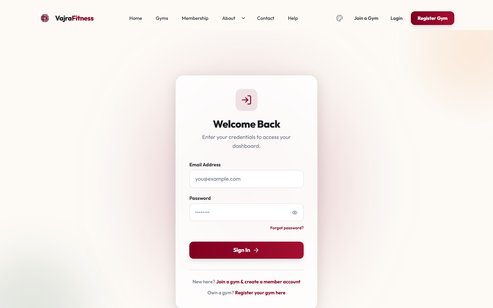

<div align="center">
  

  <h1>VajraFitness</h1>

  <p>
    <strong>Multi-tenant SaaS platform for gym and fitness-center management — memberships, billing, staff, and analytics in one system.</strong>
  </p>

  <p>
    
    
    
    
    
    
  </p>

  <p>
    <a href="https://vajra-fitness-gym-management.vercel.app"><strong>Live demo →</strong></a>
  </p>
</div>

---

## Overview

VajraFitness is a multi-tenant SaaS application for running a fitness business — from a single studio to a multi-branch chain. Each gym operates as an isolated tenant with its own members, staff, trainers, billing, and branch structure, while the platform layer handles subscriptions, plan entitlements, and cross-tenant administration.

## Screenshots

| | |
| --- | --- |
|  |  |
| Homepage | Subscription plans & checkout |
|  |  |
| About | Login |

## Features

**Multi-branch & SaaS management**
- Tiered SaaS plans with configurable member/trainer/staff limits per gym
- Strict tenant isolation — no gym can access another gym's data
- Role-based access control for Super Admin, Gym Owner, Trainer, and Staff

**Billing & analytics**
- Membership plans with automated expiry tracking
- Online payments via Razorpay, PDF receipts, refund handling
- Revenue, churn, and retention analytics per gym and platform-wide

**Member & trainer experience**
- Self-service member dashboard for attendance, payments, and membership status
- Structured workout plans and progress tracking
- Personal-training session booking and scheduling

## Tech stack

| Layer | Technologies |
| --- | --- |
| Frontend | React 19, TypeScript, Tailwind CSS v4, TanStack Query, Zustand |
| Backend | Node.js 22 LTS, Express 5, Prisma ORM |
| Database | PostgreSQL |
| Auth | JWT with rotating refresh tokens, Argon2 password hashing |
| Infra | Redis (rate limiting, caching), Razorpay (payments), Vercel Analytics & Speed Insights |

## Getting started

Requires Node.js 20+ (Node.js 22 LTS recommended) and a PostgreSQL instance (local, or a free [Neon](https://neon.tech) project).

```bash
# 1. Point at a database
#    Set DATABASE_URL in backend/.env (see backend/.env.example)

# 2. Workspace root installation
npm install --legacy-peer-deps

# 3. Backend setup
cd backend
npx prisma db push
npm run seed        # seeds demo data for local development
npm run dev         # http://localhost:5000

# 4. Frontend setup
cd ../frontend
npm run dev         # http://localhost:5173
```

Running `npm run seed` prints the demo login credentials it creates directly to the console — they are intentionally not committed to this repository. See `backend/scripts/seed*.ts` for what gets created. **Rotate all seeded credentials before using this in anything beyond local development.**

## Branches & Safe Collaboration

- **`main`**: Production release branch deployed directly to Vercel. Only stable, fully-tested commits are merged here.
- **`staging`**: Integration and collaboration branch. Friends and contributors should base feature branches off `staging`:
  ```bash
  git checkout staging
  git checkout -b feature/my-feature
  ```
- **Privacy & Security**: Real production secrets, database strings, and API keys are **never** committed to this repository. All contributors configure their own local environments via `.env.example`.

## Documentation

- [`BRANDING.md`](BRANDING.md) — Official brand identity system, vector logos, sublogos, emblems, and palettes.
- [`DEPLOYMENT.md`](DEPLOYMENT.md) — Production setup on Vercel & Neon, database migrations, backups, and CI/CD.
- [`docs/detailed_overview.md`](docs/detailed_overview.md) — In-depth architectural blueprint, data model, RBAC matrix, and API contracts.

## License

VajraFitness is proprietary software — see [`LICENSE`](LICENSE). This
repository is public for portfolio and evaluation purposes, not as an
open-source project. Found a bug or security issue? See
[`CONTRIBUTING.md`](CONTRIBUTING.md) / [`SECURITY.md`](SECURITY.md).

---

<div align="center">
  <sub>&copy; VajraFitness. All rights reserved.</sub>
</div>
