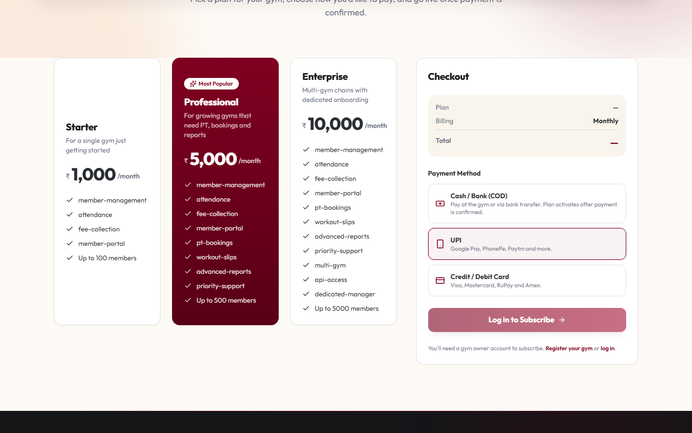
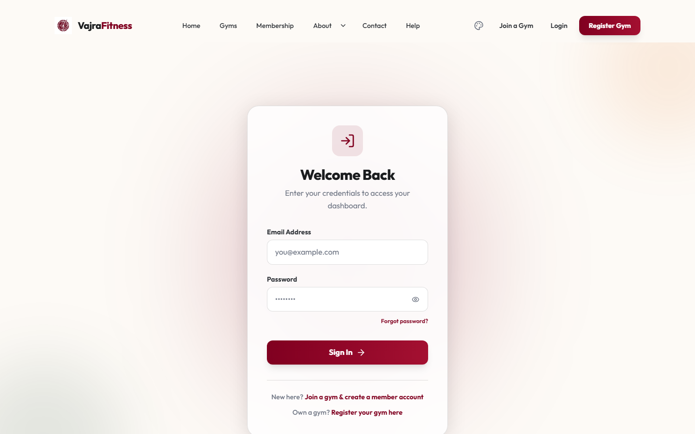

# KavachFitness

A multi-tenant web and mobile platform for running gyms. Each gym is an isolated tenant with its own members, trainers, staff, plans, fees and attendance. The platform layer handles gym approval, SaaS subscriptions, plan limits and content.

The product is called Kavach Fitness. The domain kavachfitness.in is not registered yet, so the live site is still on the Vercel address: <https://vajra-fitness-gym-management.vercel.app>

## Screenshots

| | |
| --- | --- |
|  |  |
| Homepage | Subscription plans and checkout |
|  |  |
| About | Login |

## Roles

| Role | What they do |
| --- | --- |
| `SUPER_ADMIN` | Approves and suspends gyms, manages SaaS plans and subscriptions, edits public content, reads the audit log |
| `GYM_ADMIN` | Owns one or more gyms (called partners in the UI): branches, membership plans, members, trainers, staff, fees, reports, website request |
| `TRAINER` | Works inside one gym: assigns workouts, handles personal training bookings, tracks member progress. Self-registered trainers wait for the gym owner to approve them |
| `STAFF` | Front desk work inside one gym: members, check-in, fees |
| `MEMBER` | Sees their own membership, fees, attendance, workouts and bookings |

## Sign-in pages and dashboards

| Role | Sign in | Sign up | Dashboard |
| --- | --- | --- | --- |
| Member | `/login` | `/register/member` (`?ref=CODE` applies a referral code) | `/dashboard` |
| Trainer | `/trainer/login` | `/trainer/register` | `/trainer` |
| Staff | `/login` | created by the gym owner | `/staff` |
| Gym owner (partner) | `/partner/login` | `/partner/register` | `/owner` |
| Super admin | `/admin/login` (`/admin-login` redirects, noindex) | none | `/admin` |

`/register` and `/register/vendor` redirect to `/partner/register`. Public gym pages are at `/gyms/:id` and `/g/:slug`, each with `plans`, `trainers`, `gallery` and `contact` sub-pages. The slug is a gym's `subdomain` value. A trainer invite link opens `/accept-invite?token=`.

## Features

- Gym registration with an approval step, branches, and per-gym plan limits (members, trainers, staff).
- SaaS subscriptions with trial, grace period and read-only mode once a subscription expires.
- Membership plans, renewals and automatic expiry.
- Fees with offline payment recording, PDF receipts, and online payment through Razorpay when keys are configured.
- Marketplace orders: members buy gym plans online ("Buy online"), with a commission split and a ledger for owners and admins. Needs Razorpay keys.
- Attendance check-in, workout slips (PDF), personal training bookings, group classes, progress logs and nutrition plans.
- Enquiry (lead) tracking, notices, in-app notifications, support tickets.
- Inventory, equipment, expenses, payslips and referrals.
- Revenue, churn, retention and trainer performance reports, with CSV export for revenue.
- Public pages: gym directory and gym detail pages, pricing, FAQ, legal pages, and calculators (BMI, calorie, one rep max, protein).
- Light and dark themes (no system option).
- Member self check-in (`POST /api/attendance/my/check-in`) and member referrals.
- Trainer invites: the gym owner sends an invite link, and the trainer sets up their own account.
- Find gyms: search by name, city, category, facility, price and distance, with filters kept in the URL.
- Partner website request: a gym owner asks for a slug, the super admin approves it, and the slug becomes `Gym.subdomain`, which serves `/g/:slug`.
- An Expo mobile app for members, trainers, gym owners and staff (see [docs/DOCUMENTATION.md#5-mobile-application-mobile](docs/DOCUMENTATION.md#5-mobile-application-mobile)).

## Tech stack

| Layer | Technologies |
| --- | --- |
| Frontend | React 19, TypeScript, Vite, Tailwind CSS v4, React Router, TanStack Query, Zustand, React Hook Form, Zod |
| Backend | Node.js 22, Express 5, TypeScript, Prisma 5, Zod |
| Database | PostgreSQL (Neon in production) |
| Cache and limits | Redis through ioredis. Optional: without `REDIS_URL` the app falls back to in-memory state |
| Auth | JWT access token, rotating refresh token, Argon2 password hashing |
| Payments and mail | Razorpay, SMTP through Nodemailer |
| Mobile | Expo, Expo Router, React Native |
| Hosting | Vercel (frontend and API in one project), Neon |
| Tests | Vitest and Supertest (backend, mobile), Playwright (frontend e2e) |

## Repository layout

```text
api/                 Vercel entry point, re-exports the Express app
backend/             Express API, Prisma schema and migrations, jobs, seed scripts, tests
frontend/            React single page app, Dockerfile and nginx config for the local stack
mobile/              Expo app (separate install, not an npm workspace)
scripts/dev-db.mjs   Creates and seeds a local development database
docs/                Main reference (DOCUMENTATION.md) and old notes in archive/
branding/            Brand concept files; Kavach Fitness was chosen
.github/             CI workflows, Dependabot, CODEOWNERS, PR template
docker-compose.yml   Full local stack (Postgres, Redis, Mailpit, API, web)
vercel.json          Rewrites for the single Vercel project
```

`frontend` and `backend` are npm workspaces of the root `package.json`.

## Local setup

Requirements: Node.js 22 (see `.nvmrc`), npm, and either a local PostgreSQL or Docker.

Install from the repository root. The root has no committed lockfile by design, so use `npm install`, not `npm ci`:

```bash
npm install --legacy-peer-deps
```

### Option 1: local Postgres

Start a PostgreSQL server on `localhost:5432`, then create and seed a development database:

```bash
node scripts/dev-db.mjs
```

The script creates `vajra_fitness_dev`, pushes the Prisma schema and runs the seed. It only accepts a localhost `DATABASE_URL` and exits if the host is remote or contains `neon.tech`. With no `DATABASE_URL` set it uses the `vajra_admin` role on `localhost:5432` (the same credentials the test setup expects).

Create `backend/.env` from `backend/.env.example` and point it at that database, then start the two servers:

```bash
cd backend && npm run dev     # http://localhost:5000
cd backend && npm run dev:local   # same API against the local Postgres QA db (never Neon)
cd frontend && npm run dev    # http://localhost:5173, proxies /api to port 5000
```

**Never point a local `.env` at the production database.** Seed scripts, `db push` and the test suite all write data. Use `localhost` or a separate Neon branch for development. Check `DATABASE_URL` in `backend/.env` before running any command that changes data.

`npm run seed` prints the demo accounts it creates. Seeded passwords are not published in this repository; read `backend/scripts/seed*.ts` for what gets created and rotate anything seeded outside a throwaway database.

### Option 2: Docker Compose

```bash
docker compose up --build
docker compose run --rm seed     # optional demo data
```

| Service | Address |
| --- | --- |
| Web (nginx) | <http://localhost:8080> |
| API | <http://localhost:5000> |
| Postgres | `127.0.0.1:5433` |
| Mailpit inbox | <http://localhost:8025> |

All mail from the stack goes to Mailpit and nothing leaves the machine. Every setting has a local default. To change ports or credentials, copy `docker.env.example` to `.env` at the repository root.

### Environment variables

Names only. Copy the files `.env.example` (backend and frontend blocks) and `docker.env.example` and fill them in yourself.

| Where | Variables |
| --- | --- |
| Backend, required | `DATABASE_URL`, `JWT_SECRET` (at least 32 characters, checked at startup) |
| Backend, common | `PORT`, `NODE_ENV`, `FRONTEND_URL`, `CORS_ORIGINS`, `TRUST_PROXY`, `PUBLIC_SITE_URL`, `LOG_LEVEL` |
| Backend, mail | `SMTP_HOST`, `SMTP_PORT`, `SMTP_USER`, `SMTP_PASS`, `SMTP_FROM` |
| Backend, payments | `RAZORPAY_KEY_ID`, `RAZORPAY_KEY_SECRET`, `RAZORPAY_WEBHOOK_SECRET` |
| Backend, infrastructure | `REDIS_URL`, `METRICS_TOKEN`, `CRON_SECRET`, `ALLOW_PRODUCTION_SEED` |
| Frontend | `VITE_API_URL`, `VITE_WEB_VITALS_ENDPOINT`, `VITE_PLAUSIBLE_DOMAIN` (all optional) |
| Mobile | `EXPO_PUBLIC_API_URL`, `EXPO_PUBLIC_SITE_URL` |
| Docker Compose | `POSTGRES_USER`, `POSTGRES_PASSWORD`, `POSTGRES_DB`, `JWT_SECRET`, `WEB_PORT`, `API_PORT`, `DB_PORT`, `MAILPIT_UI_PORT`, `MAILPIT_SMTP_PORT`, `API_NODE_ENV`, `SMTP_FROM`, `RAZORPAY_KEY_ID`, `RAZORPAY_KEY_SECRET` |

Only `VITE_` and `EXPO_PUBLIC_` values reach the client bundle. Never put a secret in them.

## Scripts

| Location | Command | What it does |
| --- | --- | --- |
| root | `npm run dev` / `lint` / `typecheck` / `test` / `test:e2e` | Run both dev servers, frontend lint, tsc on both, backend tests, Playwright |
| `backend` | `npm run dev` | API with file watching (`tsx watch`) |
| `backend` | `npm run build` / `npm start` | Compile to `dist/`, run `dist/server.js` |
| `backend` | `npm test` | Vitest suite against a separate test database |
| `backend` | `npm run db:push` | `prisma db push` for local development |
| `backend` | `npm run db:migrate` | `prisma migrate deploy` |
| `backend` | `npm run seed` | Super admin, demo gyms, demo members and data |
| `backend` | `npm run jobs` | Run the background jobs once |
| `backend` | `npm run backup` | `pg_dump` to `backend/backups/` |
| `frontend` | `npm run dev` / `npm run build` / `npm run preview` | Vite dev server, production build, preview |
| `frontend` | `npm run lint` | oxlint |
| `mobile` | `npm start`, `npm run typecheck`, `npm test` | See [mobile/README.md](mobile/README.md) |

## Testing

```bash
cd backend && npm test
cd frontend && npx tsc -b && npm run lint
```

The backend suite has 133 tests and takes about 12 minutes. Backend tests need a running PostgreSQL. They create and use `vajra_fitness_test` (override with `TEST_DATABASE_URL`) and never touch the development database. The suites cover authentication and token rotation, authorization and tenant isolation, memberships, subscription lifecycle and plan limits, notices, payments, trainer signup, the public gym page, and the mobile token flow.

## End-to-end tests

The `E2E` workflow (`.github/workflows/e2e-audit.yml`) builds the stack, seeds a test database and runs the Playwright smoke specs in `frontend/e2e/`:

```bash
npm run test:e2e --workspace=frontend
```

The specs expect the site at `http://localhost:4173` (`BASE_URL` overrides it). `npm run audit:a11y --workspace=frontend` runs the accessibility spec (`e2e/a11y.spec.ts`). There is no Lighthouse script and no automated SEO check.

## Branches and CI/CD

- `main` is production. Vercel deploys it on every push.
- `staging` is the integration branch. Branch feature work off `staging` and open pull requests into it. Vercel builds a preview for every non-production branch.
- CI (`deploy.yml`, job `quality`) runs on pushes to `main`, `staging` and `develop` and on pull requests to `main` and `staging`: `prisma validate`, `prisma generate`, `tsc --noEmit`, backend build, backend tests against a Postgres 16 service, frontend lint and frontend build.
- `security.yml` runs CodeQL, dependency review (pull requests), `npm audit` (report only) and a gitleaks secret scan. CodeQL also runs weekly.
- `backup.yml` takes a daily database dump when backups are enabled (see [docs/DOCUMENTATION.md#automated-backups--disaster-recovery](docs/DOCUMENTATION.md#automated-backups--disaster-recovery)).
- Seven migrations are not on the production database yet: `trainer_signup`, `fee_expense_date_indexes`, `gym_website_request`, `gym_public_profile`, `foundations_multi_gym`, `approvals_onboarding` and `marketplace_orders`. See [HANDOFF.md](HANDOFF.md).
- Schema changes must be applied to the production database with `prisma migrate deploy` before the change is merged to `main`. See [docs/DOCUMENTATION.md#database-migrations-workflow](docs/DOCUMENTATION.md#database-migrations-workflow).

Full deployment steps for Vercel and Neon are in [docs/DOCUMENTATION.md#7-deployment-infrastructure--devops](docs/DOCUMENTATION.md#7-deployment-infrastructure--devops).

## Documentation

All project documentation is consolidated in the master reference guide:

- **[Master Technical Documentation](docs/DOCUMENTATION.md)**:
  - [System Architecture & Core Patterns](docs/DOCUMENTATION.md#2-system-architecture--core-patterns)
  - [Domain Models & Database Architecture](docs/DOCUMENTATION.md#3-domain-models--database-architecture)
  - [API Specification & Contracts](docs/DOCUMENTATION.md#4-api-specification--service-contracts)
  - [Mobile Application Guide](docs/DOCUMENTATION.md#5-mobile-application-mobile) (also see [mobile/README.md](mobile/README.md))
  - [Security Policy & Threat Mitigation](docs/DOCUMENTATION.md#6-security-policy--threat-mitigation)
  - [Deployment, Infrastructure & DevOps](docs/DOCUMENTATION.md#7-deployment-infrastructure--devops)
  - [Brand Identity & Design System](docs/DOCUMENTATION.md#8-brand-identity--design-system)
  - [Contributor Guide & Engineering Standards](docs/DOCUMENTATION.md#9-contributor-guide--engineering-standards)
- *Historical plans and audit roadmaps are preserved in [docs/archive/](docs/archive/).*

## License

Proprietary. See [LICENSE](LICENSE). The repository is public for portfolio and evaluation, not as an open source project.
