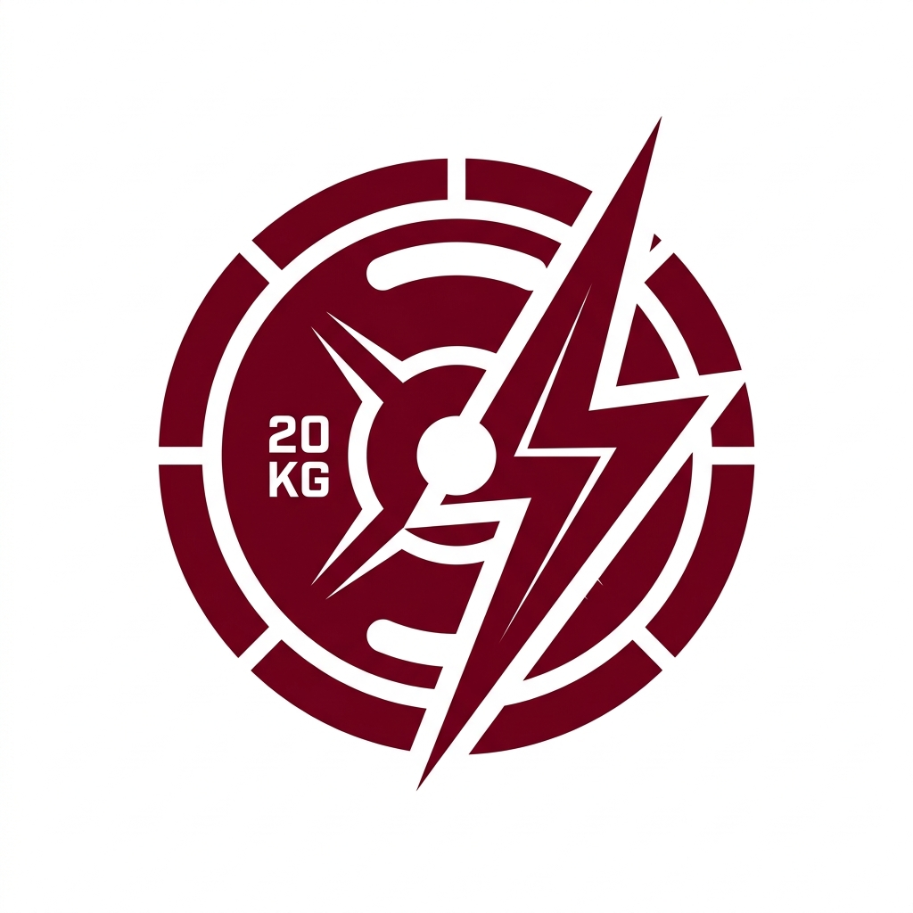

<div align="center">
  

  <h1>VajraFitness</h1>

  <p>
    <strong>Multi-tenant SaaS platform for gym and fitness-center management — memberships, billing, staff, and analytics in one system.</strong>
  </p>

  <p>
    
    
    
    
  </p>
</div>

---

## Overview

VajraFitness is a multi-tenant SaaS application for running a fitness business — from a single studio to a multi-branch chain. Each gym operates as an isolated tenant with its own members, staff, trainers, billing, and branch structure, while the platform layer handles subscriptions, plan entitlements, and cross-tenant administration.

## Features

**Multi-branch & SaaS management**
- Tiered SaaS plans with configurable member/trainer/staff limits per gym
- Strict tenant isolation — no gym can access another gym's data
- Role-based access control for Super Admin, Gym Owner, Trainer, and Staff

**Billing & analytics**
- Membership plans with automated expiry tracking
- Online payments via Razorpay, PDF receipts, refund handling
- Revenue, churn, and retention analytics per gym and platform-wide

**Member & trainer experience**
- Self-service member dashboard for attendance, payments, and membership status
- Structured workout plans and progress tracking
- Personal-training session booking and scheduling

## Tech stack

| Layer | Technologies |
| --- | --- |
| Frontend | React 19, TypeScript, Tailwind CSS v4, TanStack Query, Zustand |
| Backend | Node.js, Express 5, Prisma ORM |
| Database | PostgreSQL |
| Auth | JWT with rotating refresh tokens, Argon2 password hashing |
| Infra | Redis (rate limiting, caching), Razorpay (payments) |

## Getting started

Requires Node.js 20+ and a PostgreSQL instance (local, or a free [Neon](https://neon.tech) project).

```bash
# 1. Point at a database
#    Set DATABASE_URL in backend/.env (see backend/.env.example)

# 2. Backend
cd backend
npm install
npx prisma db push
npm run seed        # seeds demo data for local development
npm run dev          # http://localhost:5000

# 3. Frontend
cd frontend
npm install
npm run dev          # http://localhost:5173
```

Running `npm run seed` prints the demo login credentials it creates directly to the console — they are intentionally not committed to this repository. See `backend/scripts/seed*.ts` for what gets created. **Rotate all seeded credentials before using this in anything beyond local development.**

## Documentation

Architecture, authentication, multi-tenancy, payments, security, and deployment details live in [`docs/detailed_overview.md`](docs/detailed_overview.md). Deployment instructions are in [`DEPLOYMENT.md`](DEPLOYMENT.md).

## Contributing

See [`CONTRIBUTING.md`](CONTRIBUTING.md).

---

<div align="center">
  <sub>&copy; VajraFitness. All rights reserved.</sub>
</div>
