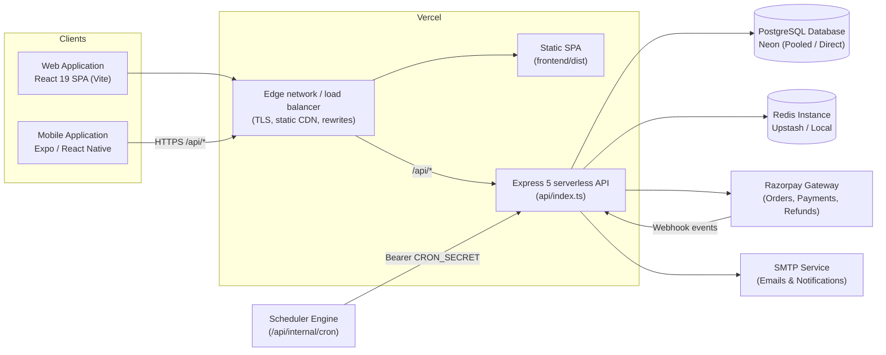
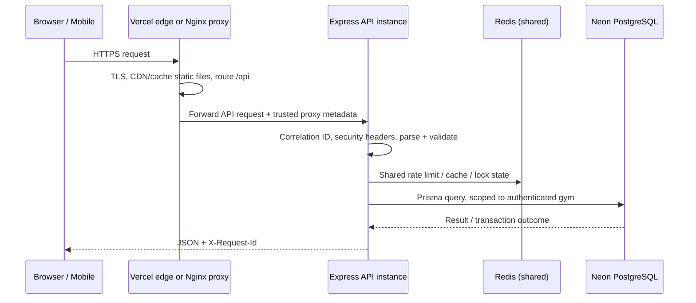

# Kavach Fitness: Technical Documentation

This is the main reference for Kavach Fitness (the domain `kavachfitness.in` is not registered yet; the site runs on a Vercel address). It covers system architecture, domain data models, API contracts, mobile architecture, security policies, deployment guides, brand identity, and engineering standards.

---

## Table of Contents

1. [Executive Summary & Platform Overview](#1-executive-summary--platform-overview)
2. [System Architecture & Core Patterns](#2-system-architecture--core-patterns)
   - [System Context Diagram](#system-context-diagram)
   - [Monorepo & Single-Origin Hosting](#monorepo--single-origin-hosting)
   - [Multi-Tenancy & Data Isolation Model](#multi-tenancy--data-isolation-model)
   - [Request Execution Pipeline](#request-execution-pipeline)
3. [Domain Models & Database Architecture](#3-domain-models--database-architecture)
   - [Core User & Roles](#core-user--roles)
   - [Gyms & Branches](#gyms--branches)
   - [Membership Lifecycle & Packages](#membership-lifecycle--packages)
   - [Payments, Fees, Refunds & Invoicing](#payments-fees-refunds--invoicing)
   - [Attendance & Activity Logs](#attendance--activity-logs)
   - [SaaS Subscriptions & Entitlements](#saas-subscriptions--entitlements)
4. [API Specification & Service Contracts](#4-api-specification--service-contracts)
   - [Global Conventions & Error Envelope](#global-conventions--error-envelope)
   - [Route Groups & Access Gates](#route-groups--access-gates)
   - [Mobile Token Contract (`X-Client: mobile`)](#mobile-token-contract-x-client-mobile)
   - [Trainer Signup & Approval Lifecycle](#trainer-signup--approval-lifecycle)
   - [Public Directory & SEO Endpoints](#public-directory--seo-endpoints)
5. [Mobile Application (`mobile/`)](#5-mobile-application-mobile)
   - [Stack & Structure](#stack--structure)
   - [Authentication & OS Keychain Integration](#authentication--os-keychain-integration)
   - [Role-Based Mobile Navigation](#role-based-mobile-navigation)
6. [Security Policy & Threat Mitigation](#6-security-policy--threat-mitigation)
   - [Threat Model & Security Controls](#threat-model--security-controls)
   - [Authentication & Session Defense](#authentication--session-defense)
   - [Reporting Vulnerabilities](#reporting-vulnerabilities)
7. [Deployment, Infrastructure & DevOps](#7-deployment-infrastructure--devops)
   - [Infrastructure Blueprint (Neon, Vercel, Upstash)](#infrastructure-blueprint)
   - [Environment Configuration](#environment-configuration)
   - [Database Migrations Workflow](#database-migrations-workflow)
   - [Scheduled Background Jobs & Automation](#scheduled-background-jobs--automation)
   - [Automated Backups & Disaster Recovery](#automated-backups--disaster-recovery)
   - [CI/CD Workflows & Verification](#cicd-workflows--verification)
8. [Brand Identity & Design System](#8-brand-identity--design-system)
   - [Brand Concept & Symbolism](#brand-concept--symbolism)
   - [Color Palette & Tokens](#color-palette--tokens)
   - [Typography & Visual Elements](#typography--visual-elements)
   - [Official Brand Assets](#official-brand-assets)
9. [Contributor Guide & Engineering Standards](#9-contributor-guide--engineering-standards)
   - [Branching Strategy](#branching-strategy)
   - [Local Development Setup](#local-development-setup)
   - [Pre-Flight Verification & Quality Gates](#pre-flight-verification--quality-gates)

---

## 1. Executive Summary & Platform Overview

**Kavach Fitness** is a multi-tenant SaaS platform for gyms and fitness studios. It covers:
- **Member Management**: Self-service portals, membership plans, automated expiry tracking, freeze/renewal workflows.
- **Attendance**: Front-desk check-in, member self check-in, visit histories. The schema has a `source` field for QR and biometric, but only manual and self check-in have screens.
- **Billing & Payments**: Integrated Razorpay online checkout, automated PDF receipts, full & partial refunds, fee ledgers, GST calculations.
- **Staff & Operations**: Role-based access for gym owners, managers, trainers, receptionists, and members; trainer commission/hourly tracking and approval workflow.
- **SaaS Subscription Engine**: Tiered B2B subscription billing for gym owners, a 14-day trial (`TRIAL_DAYS`), feature limits per plan, and platform invoices.
- **Public Discovery & SEO**: Public gym directory, gym pages at `/gyms/:id` and `/g/:slug`, calculators (BMI, calorie, 1RM, protein), sitemap and metadata.

### Roles and entry points

| Role | Sign in | Sign up | Dashboard |
|---|---|---|---|
| Member | `/login` | `/register/member` (`?ref=CODE` is sent as `referralCode`) | `/dashboard` |
| Trainer | `/trainer/login` | `/trainer/register` | `/trainer` |
| Staff | `/login` | created by the gym owner | `/staff` |
| Gym owner | `/partner/login` | `/partner/register` | `/owner` |
| Super admin | `/admin/login` (`/admin-login` redirects, noindex) | none | `/admin` |

`/dashboard` shows the member, trainer or staff dashboard by role (`DashboardRouter` in `App.tsx`). `/register` and `/register/vendor` redirect to `/partner/register`. Route names are in `frontend/src/utils/routes.ts`.

### Public gym pages and website requests

`/gyms/:id` and `/g/:slug` render the same page (`PublicGymSitePage`). The API serves it at `GET /api/public/gyms/:gymId` and `GET /api/public/sites/:slug`. A slug is a gym's `subdomain`.

To get a slug: the gym owner submits a request (`POST /api/website-requests`, status `PENDING`), and the super admin approves or rejects it (`PUT /api/website-requests/:id/approve` or `/reject`). Approval writes `desiredSlug` to `Gym.subdomain`. The table is `GymWebsiteRequest`.

### Member self check-in and referrals

A member checks in with `POST /api/attendance/my/check-in`. Referral codes live on `MemberDetails.referralCode` and the `Referral` model. The gym owner manages referrals under `/api/referrals/gym/:gymId`. A member lists their own at `/api/referrals/me` and shares `/register/member?ref=CODE`.

---

## 2. System Architecture & Core Patterns

### System Context Diagram



### Request Flow, Availability & Scaling

The production deployment is a **modular monolith**, not a set of independently deployed microservices. Domain boundaries live in route/controller/service modules; auth, gym operations, bookings, billing and reports share one API process and a tenant-scoped PostgreSQL database. This keeps transactions and tenant checks straightforward while the current team and traffic profile are small. Split a domain into a service only when it needs independent ownership, scaling, release cadence or failure isolation, and define an event/ownership contract before moving its data.



- **Networking and load balancing:** Vercel terminates HTTPS and routes static assets through its edge network while API requests reach serverless instances. In Docker, Nginx serves the SPA and proxies `/api` to the API service; an external ingress/load balancer can add API replicas. Preserve `TRUST_PROXY` only for the known proxy hop count, and only trust forwarded headers from that ingress.
- **Horizontal scaling:** API instances are stateless with respect to sessions (short-lived access JWT plus rotated refresh token); shared session revocation/database state and Redis-backed rate limits must remain external. Keep the Neon pooled URL for runtime connections to protect connection limits; use the direct URL for migrations. Bound per-instance database pools and use connection pooling when adding replicas.
- **Rate limiting and degraded dependencies:** Route-specific limits cover login, auth, public writes and user/tenant mutations; a global `/api` ceiling is 1,000 requests per 15 minutes in production. Redis shares counters across instances. The current code falls back to in-memory counters if Redis is unavailable; those limits become per-instance and are not a distributed abuse control, so production readiness should alert on Redis health and deployment policy should decide whether Redis failure is fail-open or fail-closed.
- **Dataflow and security boundaries:** Browser and mobile traffic enter through HTTPS. API middleware adds request IDs, security headers, rate limits, JWT role checks, Zod validation and server-derived tenant checks before controllers/services access Prisma. Payment amounts are computed server-side and Razorpay webhooks are signature-checked. No client-provided gym ID is trusted as an authorization decision.
- **Observability and recovery:** `/api/health` reports database/cache dependency status, `/api/ready` checks database readiness, and API responses carry a request ID for log correlation. Alert on health failures, elevated 5xx/latency, Redis fallback, Neon connection exhaustion and webhook failures; test backup restore and migration rollback procedures before production releases.

### Monorepo & Single-Origin Hosting
KavachFitness operates as a monorepo configured with `npm workspaces` for `frontend` and `backend`:
- **Single Origin**: The frontend SPA and backend API are deployed together on Vercel. Static assets are served from `frontend/dist`, and `/api/*` routes are handled by the serverless Express function at `api/index.ts`. Web clients do not require cross-origin requests; cookies are strictly first-party (`SameSite=Strict`).
- **Server Entry**: In traditional Docker or standalone Node environments, `backend/src/server.ts` starts an HTTP server listening on port 5000.
- **Mobile Independence**: `mobile/` is kept outside root `package.json` workspaces to prevent Expo dependency collisions during Vercel builds.

### Multi-Tenancy & Data Isolation Model
KavachFitness follows a **logical multi-tenancy** model within a shared PostgreSQL database:
1. **Tenant Anchor**: Every tenant business is represented by a `Gym` record.
2. **Server-Side Identification**: The caller's tenant (`gymId`) is determined exclusively by server-side authentication (`req.user.userId`). Client-provided `gymId` headers or parameters are validated against authenticated ownership or staff records before any query executes.
3. **Database Scoping**: All tenant-scoped entities (`MemberDetails`, `StaffDetails`, `TrainerDetails`, `Fee`, `Attendance`, `Membership`, `GymClass`, `Product`, `Expense`) carry a foreign key `gymId` with composite indexes for rapid, partitioned lookups.
4. **Subscription Isolation**: Unpaid or expired gyms are restricted to read-only access via server-side subscription middleware.

### Request Execution Pipeline

1. **Edge & Static Routing**: Requests matching static files are served directly from the CDN. All `/api/*` routes route to Express.
2. **Security Headers (`helmet`)**: The API sets an enforced CSP plus `X-Content-Type-Options: nosniff`, `X-Frame-Options: DENY`, `Referrer-Policy`, HSTS and `Permissions-Policy`. The static Vercel CSP is currently report-only while inline font-loader requirements are reconciled.
3. **Context & Metrics**: Injects a unique `X-Request-Id` for request correlation and increments Prometheus HTTP metrics.
4. **Rate Limiting**: Route-specific limits use shared Redis when connected and instance-local memory as a fallback. Auth uses 60 requests per 15 minutes in production, login 30 per 15 minutes, public writes 20 per hour, user writes 60 per 15 minutes, tenant writes 120 per minute and the global API ceiling is 1,000 per 15 minutes. They are off when `NODE_ENV=test`.
5. **Subscription Gate**: For tenant endpoints, `requireValidSubscription` calculates the gym's live status (`TRIAL`, `ACTIVE`, `GRACE_PERIOD`, `EXPIRED`, `SUSPENDED`). `requireWriteAccess` rejects write mutations (`POST`, `PUT`, `DELETE`) with HTTP 403 `SUBSCRIPTION_READONLY` if the gym's plan has expired.
6. **Authentication & Authorization**: `authenticate` validates the JWT bearer token, confirms the user is active, and verifies the `tokenVersion`. `authorize([...roles])` enforces role-level boundaries.
7. **Validation & Controller**: Zod schemas validate `req.body`, `req.params`, and `req.query`. Prisma transactions execute the business logic, and cache-aside layers in Redis serve hot reads.

### Backend Layers, Tenancy Checks & Auth Flow

- **Layers**: `routes/` (auth, role guard, zod) → `controllers/` (tenant check, request shaping) → `services/` (memberships, payments, subscriptions, entitlements) → Prisma. `utils/` holds env, logging, tokens, email, PDF and `time.ts`.
- **Tenant checks** go through `canAccessGym` in `backend/src/utils/tenant.ts`, which compares the gym's `ownerId` with the caller or looks up the caller's `StaffDetails`/`TrainerDetails` at that gym. Rows reached by `:id` are always resolved to their gym before any write. Super Admins pass every check.
- **"Today"** is the gym's calendar day in `APP_TIMEZONE` (default `Asia/Kolkata`), not the server's. Check-ins take a per-gym Postgres advisory lock so a double tap records one row; website requests use the same lock per gym.
- **Auth flow**: login returns a 15-minute HS256 access token plus a 7-day refresh token (httpOnly `SameSite=Strict` cookie on web, response body for `X-Client: mobile`). Refresh rotates the token; replaying a used one revokes its whole family. Logout revokes the presented token; password change or reset bumps `tokenVersion` and revokes every session. Five failed logins lock the email for 15 minutes. Reset and activation tokens are stored as sha256 hashes and claimed atomically, so each works once. On web, `POST /auth/refresh` without a cookie returns 401.
- **Known follow-up work**: class bookings can exceed capacity under concurrent booking (the count and the insert are not in one transaction); month and date filters in reports and expenses still use server time; the static site CSP in `vercel.json` remains report-only until its font-loader requirement is reconciled.

---

## 3. Domain Models & Database Architecture

The data layer is managed with **Prisma ORM** against PostgreSQL (`backend/prisma/schema.prisma`). All monetary values are stored using exact precision `Decimal(10, 2)`.

### Core User & Roles
- **`User`**: Central identity with `email` (unique), `password` (Argon2 hash), `phone`, `role`, `isActive`, and `tokenVersion` (for instant token revocation).
- **Roles**:
  - `SUPER_ADMIN`: Global platform oversight, SaaS plans, CMS, cross-tenant moderation.
  - `GYM_ADMIN`: Gym owner with full control over their own gyms and branches.
  - `BRANCH_ADMIN` / `MANAGER`: listed in the schema comment, with no sign-in page or dashboard of their own.
  - `TRAINER`: PT bookings, assigned member workouts, class schedules.
  - `STAFF`: Front-desk operations, attendance marking, member inquiries.
  - `MEMBER`: Personal gym member profile, workout slips, fee receipts, class bookings.

### Gyms & Branches
- **`Gym`**: Gym business profile (`name`, `address`, `location`, `gstNumber`, `logoUrl`, `isApproved`, `brandColor`, `subdomain`, `customDomain`). There are no opening hours, rating or gallery fields.
- **`Branch`**: Multi-location support (`gymId`, `name`, `address`, `status: PENDING | APPROVED | REJECTED`).

### Membership Lifecycle & Packages
- **`MembershipPlan`**: Catalog of gym packages (`name`, `duration` in days, `price`, `isActive`, `gymId`).
- **`Membership`**: Member subscription instance (`startDate`, `endDate`, `status: PENDING | ACTIVE | EXPIRED | SUSPENDED | FROZEN`).
  - **Renewal Chain**: Uses a recursive self-relation (`previousMembershipId` -> `renewals`) to maintain a complete renewal history.
  - **Freeze Mechanism**: `frozenAt`, `unfrozenAt`, and `freezeReason` support temporary membership pauses.

### Payments, Fees, Refunds & Invoicing
- **`Fee`**: Primary member payment ledger (`amount`, `paymentDate`, `dueDate`, `status: PAID | PENDING | OVERDUE | PARTIAL | REFUNDED`, `discount`, `tax`, `gstType: CGST_SGST | IGST`).
- **`PaymentOrder`**: Razorpay checkout linkage (`orderId`, `amount`, `status: CREATED | PAID | FAILED`).
- **Marketplace orders**: `Order` (a member buys a gym plan online via `POST /api/orders`, which needs an `Idempotency-Key` header and returns 503 `PAYMENTS_DISABLED` without Razorpay keys), `PaymentEvent` (webhook `POST /api/payments/webhook`, deduped by event), `CommissionRule` (per-gym rate, default 10%), `LedgerEntry` (MEMBER_PAID, GYM_PAYABLE, PLATFORM_COMMISSION, GST_PAYABLE; sums to zero per order) and `Refund`. Amounts are in paise. The webhook marks the order PAID, writes the ledger rows in one transaction, then activates the membership. Commission math: `backend/src/services/commission.ts` (`splitOrder`). Reads: `GET /api/orders/mine`, `GET /api/owner/earnings`, `GET /api/admin/orders`. Refunds and payouts are not built.
- **Receipts**: Auto-generated PDF receipts streaming via PDFKit (`buildFeeReceipt`).
- **Refunds**: Full or partial refunds executed via `payment.service.ts` communicating with Razorpay's refund API, updating the fee to `REFUNDED` or `PARTIALLY_REFUNDED` with audit trail entries.

### Attendance & Activity Logs
- **`Attendance`**: Timestamped record (`checkIn`, `checkOut`, `status: PRESENT | ABSENT`, `source: MANUAL | QR | BIOMETRIC`, `gymId`, `memberId`, `staffId`, `branchId`).
- **Daily Safeguard**: Controller prevents duplicate member check-ins on the same calendar day.

### Indexes

The schema has about 90 `@@index` entries, mostly `gymId` combined with a date or status column. Two were added recently: `Fee(gymId, paymentDate)` and `Expense(gymId, date)`.

### SaaS Subscriptions & Entitlements
- **`SaaSPlan`**: B2B subscription tier (`monthlyPrice`, `yearlyPrice`, quotas for `maxMembers`, `maxTrainers`, `maxStaff`, `maxBranches`, `features`).
- **`GymSubscription`**: Gym subscription lifecycle (`status: TRIAL | ACTIVE | GRACE_PERIOD | EXPIRED | SUSPENDED`, `trialEndsAt`, `gracePeriodEnd`, `billingCycle`, `razorpayOrderId`).
- **`SubscriptionInvoice`**: Formal platform invoices issued to gyms with GST breakdown (`cgst`, `sgst`, `igst`, `total`, `billingPeriod`).

---

## 4. API Specification & Service Contracts

All API endpoints are prefixed with `/api`.

### Global Conventions & Error Envelope
Standard responses return JSON. Errors consistently return:
```json
{
  "error": "Descriptive human-readable error message",
  "code": "OPTIONAL_ERROR_CODE",
  "issues": [
    { "path": "phone", "message": "phone must be a valid 10-digit Indian mobile number" }
  ]
}
```

### Route Groups & Access Gates

| Prefix | Access Level | Description |
|---|---|---|
| `/api/auth` | Public / Token | Authentication, signup, password recovery, profile management |
| `/api/public` | Public | Public gym profiles, SEO FAQs, testimonials, statistics |
| `/api/payments` | Authenticated | Razorpay order creation, payment verification, refunds, webhooks |
| `/api/saas` | Gym Admin / Super Admin | SaaS plan purchases, checkout, subscription management |
| `/api/admin` | Super Admin | Platform-wide analytics, tenant moderation, CMS content |
| `/api/gym` | Gym Admin / Staff | Gym profile, branding, branch settings |
| `/api/members` | Gym Admin / Staff / Member | Member registration, profile lookups, bulk CSV import |
| `/api/memberships` | Gym Admin / Member | Member package enrollments, renewal execution |
| `/api/fees` | Gym Admin / Member | Fee ledger management, receipt PDF downloads |
| `/api/attendance` | Gym Admin / Staff / Member | Check-in registration and visit history |
| `/api/workouts` | Gym Admin / Trainer / Member | Workout slip creation and PDF export |
| `/api/bookings` | Trainer / Member | Personal training session scheduling |
| `/api/classes` | Gym Admin / Trainer / Member | Group fitness classes and attendance |
| `/api/website-requests` | Gym Admin / Super Admin | Website slug requests and approval |
| `/api/referrals` | Gym Admin / Member | Referral codes and stats |
| `/api/orders`, `/api/owner/earnings` | Member / Gym Admin | Marketplace orders and gym earnings |
| `/api/uploads`, `/api/files`, `/api/images` | Authenticated / signed link / public | File uploads and downloads |
| `/api/internal/cron` | Bearer `CRON_SECRET` | Scheduled background automation |

### Mobile Token Contract (`X-Client: mobile`)
Because mobile applications cannot reliably use browser cookie jars, KavachFitness supports an explicit mobile token contract:
- The mobile client sends the HTTP header: `X-Client: mobile`.
- **`POST /api/auth/login` & Register**: Instead of setting an `httpOnly` cookie, returns the refresh token directly in the JSON response:
  ```json
  {
    "message": "Logged in successfully",
    "token": "<15-minute JWT>",
    "refreshToken": "<96-character hex token>",
    "user": { "id": "uuid", "username": "Rohan", "email": "rohan@example.com", "role": "MEMBER" }
  }
  ```
- **`POST /api/auth/refresh`**: Accepts `{ "refreshToken": "..." }` in the request body. Rotates the refresh token and returns a fresh pair `{ token, refreshToken }`.
- **Token Reuse Detection**: If an invalidated refresh token is presented, the entire session family is revoked immediately to mitigate session hijacking.
- **`POST /api/auth/logout`**: Revokes the refresh token passed in the request body.

### Trainer Signup & Approval Lifecycle
1. **Public Signup**: `POST /api/auth/register/trainer` allows trainers to self-register for an approved gym.
2. **Pending Gate**: Accounts start with `trainerStatus: "PENDING"`.
3. **Protected Account Access**: Pending or rejected trainers can access only account management endpoints (`/auth/me`, `/auth/profile`, `/auth/logout`). All other endpoints return HTTP 403 `TRAINER_PENDING` or `TRAINER_REJECTED`.
4. **Gym Admin Approval**: The gym owner reviews applications via `/api/staff/trainer-applications/:id` and approves or rejects them.
5. **Invites**: The gym owner creates an invite (`POST /api/trainers/invites`, listed with `GET`, revoked with `DELETE /api/trainers/invites/:id`). The invitee opens `/accept-invite?token=` and calls `POST /api/auth/accept-invite` with {token, name, password}. That creates an ACTIVE trainer and logs them in.

### Marketplace orders and ledger
- `POST /api/orders` (member, needs an `Idempotency-Key` header) creates an order for a membership plan. Without Razorpay keys it returns 503 `PAYMENTS_DISABLED`.
- `POST /api/payments/webhook` records each event once. In one transaction it marks the order PAID, writes the ledger rows (MEMBER_PAID, GYM_PAYABLE, PLATFORM_COMMISSION, GST_PAYABLE, summing to zero) and activates the membership.
- Amounts are in paise. `splitOrder` in `backend/src/services/commission.ts` does the math: commission on the pre-GST price (default 10%, per-gym `CommissionRule`), 18% GST on the commission.
- `GET /api/orders/mine`, `GET /api/owner/earnings`, `GET /api/admin/orders`. Order logic is in `backend/src/services/order.service.ts`.

### Approvals
`backend/src/services/approval.service.ts` holds the transition rules. Gym identity fields (name, address, city, state, phone, email, GST) are sent by `PUT /api/gym/my-branch` as one open approval request. The super admin lists requests at `GET /api/admin/approvals` and decides at `POST /api/admin/approvals/:id/decide`. The owner sees theirs at `GET /api/gym/my-branch/change-requests`.

### Public Directory & SEO Endpoints
- `GET /api/gym`: Lists approved gyms (`status` is `APPROVED`). Filters: q, city, category, facility, minPrice, maxPrice, lat/lng/radiusKm. Sort: relevance, price, distance, newest. Paging: page, limit (max 50). Returns a plain array, or `{items, total, page}` with `?paged=1`.
- `GET /api/gym/cities`: Cities that have listed gyms.
- `GET /api/public/gyms/:gymId` and `GET /api/public/sites/:slug`: Publicly visible gym details and membership plans.
- `GET /api/public/sitemap.xml`: Dynamically generated XML sitemap incorporating static routes, SEO calculators, and public gym URLs.

### Multi-gym members, uploads and versioning
- Every route is also served under `/api/v1`.
- A member can belong to several gyms (`MemberDetails` is unique per user and gym). `GET /api/members/my-gyms` lists them, and clients send the active gym in the `X-Gym-Id` header (`canAccessGym` in `backend/src/utils/tenant.ts` checks it).
- Files: `POST /api/uploads?kind=` stores a file (local disk for now; `GALLERY` photos are public at `GET /api/images/:id`), `GET /api/uploads/:id/link` returns a 5-minute signed link, and `GET /api/files/:token` serves it.
- When the database cannot be reached the API answers `503` with code `DB_UNREACHABLE`; the web and mobile clients show an outage screen.
- Gym `facilities` is returned as a list of strings.
- Decisions: GST is added on top of the plan price only for gyms with a GSTIN. Gyms and users that have money records are to be soft-deleted (deactivated or suspended), not deleted. This is planned, not built.
- Gym profile changes go through approval requests (`ApprovalRequest` / `ApprovalEvent` / `ApprovalDocument`), decided at `/api/admin/approvals`. Trainer onboarding tables (qualifications, availability, invites) are in use. See `HANDOFF.md` for status and duplicate-gym rules.

---

## 5. Mobile Application (`mobile/`)

### Stack & Structure
The mobile client is built with **Expo SDK 58** and **React Native**, using **Expo Router**:
- Stored in `mobile/` with isolated dependencies and configuration.
- Styled using a dedicated design tokens theme (`src/theme.ts`) aligning with the web burgundy and slate aesthetic.
- Server communication managed through **TanStack Query** with automated single-flight token refresh.

### Authentication & OS Keychain Integration
- Refresh tokens are securely stored using `expo-secure-store` (backed by iOS Keychain and Android Keystore).
- Short-lived JWT access tokens reside solely in memory.
- `src/api/client.ts` intercepts 401 errors, performs atomic refresh calls, and replays failed queries seamlessly.

### Role-Based Mobile Navigation
Upon launch, `app/index.tsx` inspects `user.role` and routes the user into specific tab layouts:
- **Member**: Home, Workout Slips, Attendance History, Fee Receipts, Profile.
- **Trainer**: Daily Schedule, Assigned Members, PT Bookings, Profile.
- **Gym Admin & Staff**: Front-desk check-in scanner, member lookup, active attendances.
- **Super Admin**: Not supported in the app; uses the website.

---

## 6. Security Policy & Threat Mitigation

### Threat Model & Security Controls

| Threat Vector | Defense Architecture |
|---|---|
| **Credential Stuffing & Brute Force** | Argon2 password hashing; progressive login lockouts tracked in Redis; tight rate limiting on `/auth` routes. |
| **Token Theft & Replay** | 15-minute access token lifespan in memory; 7-day refresh tokens rotated upon every invocation; reuse detection destroys session family. |
| **Cross-Tenant Data Tampering** | Tenant ID resolved on server via authentication context; parameterized queries through Prisma; automated cross-tenant security test suites. |
| **Cross-Site Scripting (XSS)** | React automatic string escaping; enforced API CSP and report-only static-site CSP; no usage of unescaped HTML injection. |
| **Cross-Site Request Forgery (CSRF)** | Web refresh token uses `httpOnly`, `SameSite=Strict` cookies; origin and referer header validation on refresh requests. |
| **SQL Injection** | Prisma ORM uses parameterized queries exclusively. |
| **Financial / Payment Tampering** | Order prices derived on the server from the fee records; Razorpay webhook signatures verified via HMAC-SHA256 using raw request payloads. |
| **Secret Exposure** | `.env*` files git-ignored; secret scanning (gitleaks) integrated into CI; separate direct vs pooled database URLs. |

### Authentication & Session Defense
- **Token Versioning**: `tokenVersion` on the `User` model is encoded in JWT claims. Password changes, account freezes, or administrative resets increment this integer, instantly invalidating all active access tokens.
- **Indexing**: `frontend/public/robots.txt` disallows the private consoles, login, register and reset paths. The admin login also has a `noindex, nofollow` meta tag, and `vercel.json` sends `X-Robots-Tag: noindex, nofollow` on the same paths.

### Reporting Vulnerabilities
Security vulnerabilities should be reported privately:
- By email to security@kavachfitness.in (the domain is not registered yet), or
- Via **GitHub Security Advisories** on the repository ("Report a vulnerability").
- Maintainers review and patch reports prior to public disclosure.

---

## 7. Deployment, Infrastructure & DevOps

### Infrastructure Blueprint
- **Hosting**: Vercel (Production branch `main`, Preview branches for pull requests).
- **Database**: PostgreSQL on **Neon**:
  - `DATABASE_URL`: **Pooled connection string** (PgBouncer) for serverless API runtime.
  - `DIRECT_URL`: **Direct unpooled connection** for Prisma migrations, backups, and CLI operations.
- **Cache & Rate Limiting**: Upstash Redis (configured via `REDIS_URL`).
- **Payment Gateway**: Razorpay (Webhooks directed to `https://<domain>/api/payments/webhook`).

### Environment Configuration

| Variable | Required | Description |
|---|---|---|
| `DATABASE_URL` | Yes | Neon pooled PostgreSQL connection string |
| `DIRECT_URL` | Yes (Migrations) | Neon direct connection string (no pooler) |
| `JWT_SECRET` | Yes | Cryptographic secret for signing JWTs (>= 32 chars) |
| `NODE_ENV` | Yes | Set to `production` in staging and production |
| `FRONTEND_URL` | Yes | Canonical public URL of the web platform |
| `TRUST_PROXY` | Yes | Set to `1` behind Vercel reverse proxy |
| `REDIS_URL` | Recommended | Upstash Redis connection string for distributed caching |
| `RAZORPAY_KEY_ID` | Optional | Razorpay public key ID |
| `RAZORPAY_KEY_SECRET` | Optional | Razorpay private API secret |
| `CRON_SECRET` | Required on Vercel | Bearer secret for `/api/internal/cron`. Vercel Cron calls it daily at 03:00 UTC (see `vercel.json`) |
| `RAZORPAY_WEBHOOK_SECRET`| Optional | Secret for verifying incoming Razorpay webhooks |
| `SMTP_*` | Optional | SMTP mail credentials for activation & password emails |

### Database Migrations Workflow
Prisma schema migrations are located in `backend/prisma/migrations/`.
1. **Never apply migrations automatically on Vercel deployment.**
2. When creating schema changes, generate migrations locally:
   ```bash
   cd backend
   npx prisma migrate dev --name <migration_name>
   ```
3. Apply migrations to the production/staging Neon database using the **direct connection string**:
   ```bash
   cd backend
   DATABASE_URL="<neon_direct_url>" npm run db:migrate
   ```
4. Pending on production: `20261022191554_trainer_signup`, `20261025000000_fee_expense_date_indexes`, and `GymWebsiteRequest`. The last one was created with `db push` and has no migration file yet; write one before deploying.
5. Migrations must be strictly **additive** (nullable columns, new tables) to maintain backward compatibility during code deployments.

### Scheduled Background Jobs & Automation
Automated platform operations are consolidated in `backend/src/jobs/scheduler.ts`:
- Expiring elapsed memberships.
- Dispatching pre-expiry membership notifications.
- Sending fee due reminders.
- Reconciling pending Razorpay payment orders.
- Executing subscription grace-period transitions and dunning.

**Triggering Execution**:
- On long-running Node/Docker servers: Runs automatically at boot and hourly.
- On Vercel: Invoked by Vercel Cron (`GET`) or an external monitor calling `POST /api/internal/cron` with header `Authorization: Bearer <CRON_SECRET>`.

### Automated Backups & Disaster Recovery
- Nightly backups run via `.github/workflows/backup.yml` using `pg_dump`.
- Dumps are GPG-encrypted before upload to prevent data exposure.
- Backups can optionally be replicated to an AWS S3 bucket (`AWS_S3_BACKUP_BUCKET`).
- Test restoration verification:
  ```bash
  gunzip -c backup.sql.gz | psql "$SCRATCH_DATABASE_URL"
  ```

### CI/CD Workflows & Verification
The repository maintains automated GitHub Actions workflows:
- **`deploy.yml` (`quality`)**: Runs on pushes/PRs. Executes Prisma validation, TypeScript compiler (`tsc --noEmit`), backend test suite against PostgreSQL 16 container, frontend linter (`oxlint`), and Vite production build.
- **`security.yml`**: Runs GitHub CodeQL analysis, dependency vulnerability scans, and gitleaks secret detection.
- **`e2e-audit.yml`**: Runs the Playwright smoke tests in `frontend/e2e/`.

---

## 8. Brand Identity & Design System

### Brand Concept & Symbolism
**"Kavach" (कवच)** is the Sanskrit word for armour or shield. Kavach Fitness was chosen from three concepts in `branding/`; the others are archived. The domain `kavachfitness.in` is not registered yet.

### Theme, Tokens & Typography
Light and dark themes only (no system option). Tokens are CSS variables in `frontend/src/index.css`; see [DESIGN.md](../DESIGN.md) for values. Burgundy `#800020` is the primary color in light mode. Fonts are Outfit for body and Bebas Neue for display headings.

### Official Brand Assets
Vector assets are stored in `frontend/public/`:
- `logo.svg`: Primary brand icon mark.
- `logo-horizontal.svg`: Sublogo for invoices, letterheads, and headers.
- `favicon.svg`: Browser tab icon and PWA mark.
- `branding-badge.svg`: Circular seal for certificates and workout slips.
- `branding-emblem.jpg`: High-resolution 3D emblem for social cards and splash screens.

---

## 9. Contributor Guide & Engineering Standards

### Branching Strategy
- **`main`**: Production release branch. Deployed directly to Vercel. Only stable, fully tested releases are merged here.
- **`staging`**: Integration and active development branch.
- **Feature Branches**: Cut from `staging` (`feature/<feature-name>`), submitted via Pull Requests back into `staging`.

### Local Development Setup
Prerequisites: Node.js 22 LTS, Docker or local PostgreSQL.

```bash
# 1. Clone repository
git clone https://github.com/Himanshusingh204/vajra-fitness-gym-management.git
cd vajra-fitness-gym-management

# 2. Install monorepo dependencies
npm install --legacy-peer-deps

# 3. Spin up local database (Docker or local Postgres)
node scripts/dev-db.mjs

# 4. Backend setup
cd backend
cp .env.example .env
# Set DATABASE_URL to local postgres (the dev-db script uses the vajra_fitness_dev database)
npx prisma db push
npm run seed        # Seeds demo users, gyms, plans
npm run dev         # Runs on http://localhost:5000

# 5. Frontend setup (new terminal)
cd ../frontend
cp .env.example .env
npm run dev         # Runs on http://localhost:5173
```

### Pre-Flight Verification & Quality Gates
Before opening a pull request or pushing to `staging`, execute the following checks locally:

```bash
# Backend verification
cd backend
npx prisma validate
npx tsc --noEmit
npm test

# Frontend verification
cd ../frontend
npx tsc -b
npm run lint
npm run build
```

Test commands: `npm test` in `backend` runs 133 Vitest tests and takes about 12 minutes. `npm run test:e2e` in `frontend` runs the Playwright specs, and `npm run audit:a11y` runs the axe accessibility spec.

### Known Gaps
- Razorpay keys are not configured, so online payment is off. Marketplace orders and the ledger exist locally only. Activation happens only through the webhook; there is no order verify endpoint yet.
- SaaS plan prices are not decided.
- No WhatsApp or SMS sending.
- No real gym photos.
- No Expo, Google Play or Apple developer accounts yet.
- Not done: Lighthouse runs, automated SEO checks, a manual screen reader pass.

---
*For historical plans, audit logs, and legacy roadmaps, refer to `docs/archive/`.*
