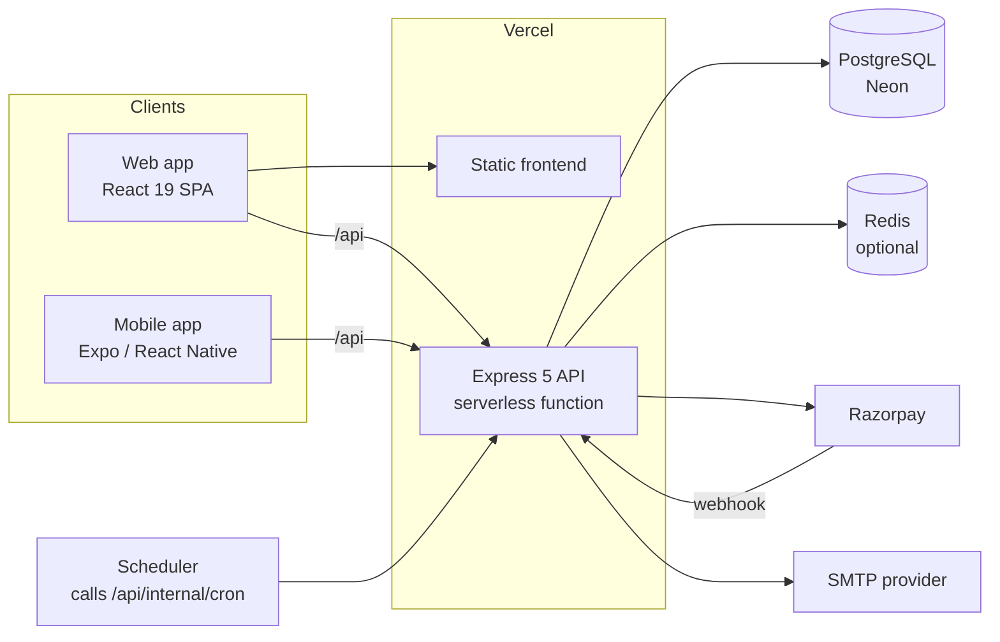

# Architecture

How VajraFitness is put together today, and where it would change under more load. Features and endpoints are in [detailed_overview.md](detailed_overview.md). Setup and deployment are in [../README.md](../README.md) and [../DEPLOYMENT.md](../DEPLOYMENT.md).

## System context



One repository, one Vercel project. The SPA and the API share an origin, so the web client needs no CORS and its cookies are first-party. The API entry for Vercel is `api/index.ts`, which re-exports the Express app from `backend/src/app.ts`. The same app also runs as a normal Node server through `backend/src/server.ts` (local development, Docker).

## Roles and tenancy

| Role | Scope |
| --- | --- |
| `SUPER_ADMIN` | The whole platform: gyms, SaaS plans and subscriptions, content, audit log |
| `GYM_ADMIN` | The gyms they own |
| `TRAINER`, `STAFF` | One gym, optionally one branch |
| `MEMBER` | Their own records inside one gym |

Tenancy is enforced in queries as well as in route guards. Tenant tables carry a `gymId`, and controllers work out the caller's gym from the authenticated user instead of trusting an id from the client. `backend/tests/authorization.test.ts` and `backend/tests/security.test.ts` try to cross gym boundaries.

## Request path

1. **Static files.** The built frontend is served by Vercel from `frontend/dist`. Unknown paths fall back to `index.html`. `vercel.json` has no custom header rules.
2. **API setup** (`backend/src/app.ts`). `helmet` sets security headers (CSP, HSTS, frame-ancestors, referrer policy), a Permissions-Policy header is added, a request id is assigned and echoed as `X-Request-Id`, request metrics are recorded, CORS is checked against `FRONTEND_URL` and `CORS_ORIGINS`, and a global rate limit applies to `/api` (200 requests per 15 minutes per client, stored in Redis when configured). Auth, registration and write routes have tighter limits.
3. **Subscription gate.** For tenant routes, `requireValidSubscription` identifies the caller from the bearer token and derives the gym's subscription state (`TRIAL`, `ACTIVE`, `PAST_DUE`, `GRACE_PERIOD`, `EXPIRED`, `SUSPENDED`, `CANCELLED` or none) from the database, with a 30 second in-memory cache. `requireWriteAccess` then blocks writes when the gym is read-only (expired, suspended or no plan). State is computed from dates at request time, so it does not depend on a scheduler having run. Super admins bypass it.
4. **Authentication.** `authenticate` verifies the JWT (HS256) and re-reads the user, so deactivated users and users whose `tokenVersion` changed are rejected immediately. Trainers whose application is pending or rejected get `403 TRAINER_PENDING` or `TRAINER_REJECTED` on everything except account endpoints.
5. **Handler.** Zod validates input, Prisma runs the queries, and hot read endpoints (dashboard stats, public gym data) use a short cache-aside layer in Redis (`backend/src/utils/cache.ts`). Without Redis the cache is skipped and queries run each time.

## Authentication

- Passwords: Argon2. Older bcrypt hashes are rehashed to Argon2 on successful login.
- Login lockout: repeated failures for an email lock further attempts. Counters live in Redis when `REDIS_URL` is set and in process memory otherwise.
- Access token: JWT, 15 minutes. The web app keeps it in memory only. The mobile app keeps it in memory too.
- Refresh token: opaque, stored hashed in Postgres, valid for 7 days, rotated on every use. Presenting an already used token revokes the session family.
  - Web: sent as an `httpOnly`, `SameSite=Strict` cookie. The refresh endpoint also checks the `Origin` or `Referer` header against the allowed origins.
  - Mobile: the app sends `X-Client: mobile`; the refresh token then travels in the JSON body instead of a cookie and is stored in the OS keychain.
- `tokenVersion` on the user is part of the JWT. Password changes and resets, and account suspension, increment it, which invalidates existing access tokens.

## Data

PostgreSQL through Prisma. The schema is in `backend/prisma/schema.prisma` and has about 40 models. Money columns such as fees and subscription amounts use `Decimal`. Migrations are committed under `backend/prisma/migrations/` and applied with `prisma migrate deploy`; see [../DEPLOYMENT.md](../DEPLOYMENT.md) for the order of operations.

Payments: orders are created server-side with the amount taken from the fee record. Settlement runs after signature verification, either from the client verify call or the Razorpay webhook (which reads the raw request body). Settlement is idempotent: the payment order is claimed with a conditional update, so a verify call and a webhook for the same order settle it once.

## Background jobs

`backend/src/jobs/scheduler.ts` expires memberships, sends expiry and fee reminders, reconciles payment orders and runs subscription dunning. Each job is idempotent. A long-running server runs them at boot and hourly. On Vercel they run when `/api/internal/cron` is called with `Authorization: Bearer <CRON_SECRET>`; the endpoint answers 401 if `CRON_SECRET` is unset. No cron schedule is defined in `vercel.json` today.

## Observability

- Structured request logs with a correlation id (`X-Request-Id`).
- Prometheus metrics at `/metrics`. If `METRICS_TOKEN` is set, a bearer token is required.
- `/api/health` returns `OK` with database and cache status, or 503 when the database is unreachable. `/api/ready` checks the database. The backend Docker image uses `/api/health` for its health check.
- Vercel Analytics and Speed Insights are included in the frontend and need enabling in the Vercel dashboard.
- Daily database dumps through `.github/workflows/backup.yml`, once the repository variables and secrets described in DEPLOYMENT.md are set. Dumps uploaded as artifacts are GPG-encrypted.

## Security controls

| Threat | Control |
| --- | --- |
| Credential stuffing | Argon2, per-email lockout, per-route rate limits |
| Token theft | 15 minute access token held in memory, rotating refresh token with reuse detection, `httpOnly` `SameSite=Strict` cookie on web |
| Cross-tenant access | `gymId` resolved on the server, covered by authorization tests |
| Mass assignment | Zod schemas accept known fields only |
| XSS | React escaping, CSP set by `helmet` on API responses, no `dangerouslySetInnerHTML` in `frontend/src` |
| CSRF | `SameSite=Strict` refresh cookie, bearer tokens for API calls, origin check on refresh |
| Injection | Prisma parameterized queries. The only raw queries are fixed `SELECT 1` health checks |
| Payment tampering | Amounts computed on the server, signature verification on verify and webhook |
| Secrets in the repo | `.env*` ignored except `.env.example`, gitleaks in CI |
| Dependencies | Dependabot, dependency review, `npm audit` and CodeQL in CI |

The CSP above comes from the API process. The static frontend gets nosniff, frame, referrer, permissions and HSTS headers from `vercel.json` but no CSP yet, and `frontend/nginx.conf` (local Docker stack only) also sets none. Reporting a vulnerability: see [../SECURITY.md](../SECURITY.md).

## Scaling notes

These are directions, not features that exist.

| Pressure | Likely change |
| --- | --- |
| Repeated dashboard and analytics reads | Caching is already in place for the hot endpoints; add composite indexes based on `pg_stat_statements` |
| Email, PDF and reminder volume | Move them to a queue and a worker instead of the request or the cron call |
| Very large `Attendance` or `AuditLog` tables | Partition by month and archive old partitions |
| Heavy reporting | Read replica for `/reports` and analytics |
| Customers in several regions | Regional API deployments close to the database primary or replicas |

Serverless functions open many database connections, so `DATABASE_URL` should be the pooled Neon string in production. Rate limits and lockout counters need `REDIS_URL` once more than one instance runs.

## Repository layout

```text
api/                 Vercel entry, re-exports the Express app
backend/             Express API, Prisma schema and migrations, jobs, seed scripts, tests
frontend/            React SPA, Dockerfile and nginx.conf for the local stack
mobile/              Expo app (separate install, not an npm workspace)
scripts/dev-db.mjs   Local development database helper
docs/                Documentation
.github/             Workflows, Dependabot, CODEOWNERS, templates
```

## Clients

- **Web:** route-level code splitting, light, dark and system themes, per-page meta tags through `usePageMeta`, a web app manifest (`frontend/public/manifest.webmanifest`), `robots.txt` and `llms.txt` in `frontend/public`. The API serves the sitemap at `/api/public/sitemap.xml`, and `vercel.json` rewrites `/sitemap.xml` to it. Public pages are prerendered after the Vite build (`frontend/scripts/prerender.mjs`, fail-soft).
- **Mobile:** Expo Router, same REST API, role-based tab sets. See [mobile.md](mobile.md).
